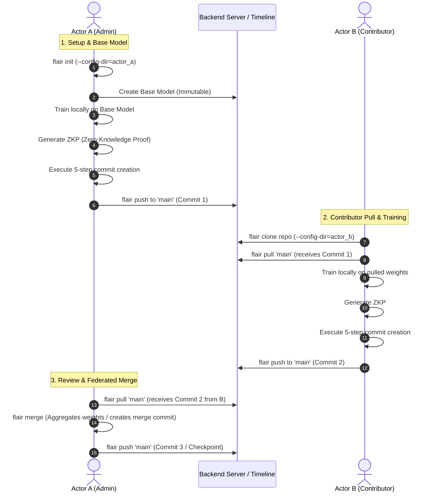

# Federated Learning CLI: Complete Testing Agenda

This document serves as the master testing specification for the Federated Learning ML Weight Tracking CLI (`flair`). It details the end-to-end multi-actor workflow, Zero-Knowledge Proof (ZKP) mocking, 5-step commit lifecycle, serial timeline management, and automated test harnesses.

---

## 1. Executive Summary & Architecture

- **Scope**: Rigorous unit, integration, and multi-actor workflow testing.
- **Branching Policy**: Strictly linear `main` branch (no branch switching in this phase).
- **Core Entities**:
  - **Actor A (Admin)**: Initializes repository, creates immutable base model, trains, creates ZKP, executes 5-step commit, pushes, and retains merge rights.
  - **Actor B (Contributor)**: Clones repository, pulls from `main`, trains locally, generates ZKP, creates 5-step commit, pushes to `main`.
  - **Backend**: Enforces first-come, first-served serial commit order and base model immutability.

---

## 2. Multi-Actor End-to-End Workflow Timeline



---

## 3. Test Harness & Fixture Design (`conftest.py`)

### 3.1 Multi-Actor Environment Isolation
Tests simulate two completely separate local environments using `pytest`'s `tmp_path`:

```python
import pytest

@pytest.fixture
def multi_actor_env(tmp_path):
    actor_a_dir = tmp_path / "actor_a"
    actor_a_config = tmp_path / "actor_a_config"
    actor_b_dir = tmp_path / "actor_b"
    actor_b_config = tmp_path / "actor_b_config"

    actor_a_dir.mkdir()
    actor_a_config.mkdir()
    actor_b_dir.mkdir()
    actor_b_config.mkdir()

    return {
        "actor_a": {"cwd": actor_a_dir, "config": actor_a_config, "role": "admin"},
        "actor_b": {"cwd": actor_b_dir, "config": actor_b_config, "role": "contributor"},
    }
```

### 3.2 Mocking ZKP Generation
To keep test execution fast (under 2 seconds per test):
- Unit & integration tests mock `zkp.generate_proof()` and `zkp.verify_proof()` with deterministic dummy strings/hashes.
- Cryptographic validity tests are isolated behind `@pytest.mark.crypto` and run on-demand.

### 3.3 Mocking Dual-Tier Authentication (Wallet JWT + OAuth2)
- Pre-generated mock JWT signed by an authorized admin wallet for Actor A.
- Pre-generated mock JWT signed by a contributor wallet for Actor B.
- Mock OAuth2 provider injecting valid and expired tokens.

---

## 4. Test Suites & Verification Matrix

### Suite 1: Base Model Lifecycle & Immutability
| Test ID | Scenario | Execution | Expected Result |
| :--- | :--- | :--- | :--- |
| `BASE-01` | First-time Base Model Creation | Actor A runs `flair init` and registers base model | Backend registers model; Exit Code `0` |
| `BASE-02` | Disallowed Base Model Overwrite | Actor A attempts to re-create or overwrite base model | CLI and backend reject operation with clear error; Exit Code `1` |
| `BASE-03` | Unauthorized Contributor Init | Actor B attempts to initialize base model | Operation denied (insufficient privileges); Exit Code `2` |

---

### Suite 2: The 5-Step Commit Creation & ZKP
Tests the atomic execution of commit generation.

| Test ID | Scenario | Execution | Expected Result |
| :--- | :--- | :--- | :--- |
| `CMT-01` | Full 5-Step Execution | Weights staged -> Delta calculated -> ZKP generated -> Signed with wallet -> Metadata recorded | Commit cleanly staged and ready for push; Exit Code `0` |
| `CMT-02` | Abort at Step 2 (Delta calculation failure) | Simulate disk error or missing base weights | Clean rollback; no corrupted commit metadata created |
| `CMT-03` | Abort at Step 3 (ZKP generation failure) | ZKP generator raises exception | Commit creation aborted cleanly; no orphaned proof files; Exit Code `1` |
| `CMT-04` | Abort at Step 4 (Wallet signing rejection) | User/wallet rejects signature request | Commit aborted without saving un-signed commit; Exit Code `2` |

---

### Suite 3: Contributor Pull & Push Flow (Actor B)
| Test ID | Scenario | Execution | Expected Result |
| :--- | :--- | :--- | :--- |
| `FLOW-B1`| Clone & Pull Initial Model | Actor B clones repository and pulls `main` | Downloads base model weights; SHA256 checksum verified; Exit Code `0` |
| `FLOW-B2`| Train & Push Contributor Commit | Actor B trains, generates ZKP, commits, and pushes to `main` | Backend records Commit 2 in linear serial timeline; Exit Code `0` |
| `FLOW-B3`| Corrupted Pull Detection | Mock backend returns corrupted payload to Actor B | Checksum validation fails; local weight state unchanged; Exit Code `3` |

---

### Suite 4: Merge & Checkpoint Push Flow (Actor A)
| Test ID | Scenario | Execution | Expected Result |
| :--- | :--- | :--- | :--- |
| `MRG-01` | Actor A Pulls Contributor Changes | Actor A pulls `main` after Actor B has pushed | Actor A's local timeline reflects Actor B's Commit 2; Exit Code `0` |
| `MRG-02` | Federated Merge Execution (`flair merge`) | Actor A runs `flair merge` on Commit 2 | Lineage metadata updated, aggregated weights produced, merge commit staged; Exit Code `0` |
| `MRG-03` | Merge Push to `main` | Actor A pushes merge commit back to `main` | Backend advances timeline head to Commit 3 (Checkpoint); Exit Code `0` |
| `MRG-04` | Non-Admin Merge Attempt | Actor B attempts to execute `flair merge` or push merge commit | Operation rejected due to lack of merge rights; Exit Code `2` |

---

## 5. Standardized Exit Codes & CLI Output Assertions

Every command executed in the tests must assert exact exit codes:

| Exit Code | Meaning | Example Trigger |
| :---: | :--- | :--- |
| `0` | **Success** | Clean commit, push, pull, or merge |
| `1` | **Validation / Timeline Error** | Attempting to overwrite base model, broken state |
| `2` | **Authentication / Permission Error** | Actor B attempting merge, wallet signature rejection |
| `3` | **Network / Checksum Error** | Corrupted download bytes, failed upload retries |

---

## 6. Recommended Test Directory Structure

```
tests/
├── conftest.py                   # multi_actor_env, mock ZKP fixtures, mock auth tokens
├── unit/
│   ├── test_auth.py              # Wallet JWT & OAuth2 mock checks
│   ├── test_zkp_mock.py          # Fast mock proof generation/verification
│   ├── test_commit_steps.py      # 5-step commit state transitions & rollback
│   └── test_cli_exit_codes.py    # Output format & exit code assertions
└── integration/
    ├── test_base_model.py        # Base model creation & immutability guards
    ├── test_actor_b_workflow.py  # Clone, pull, local train, push
    └── test_actor_a_merge.py     # Pull contributor commit, flair merge, push checkpoint
```

---

## 7. Execution Command

To run the complete fast test suite:
```bash
pytest tests/unit tests/integration -v --tb=short
```
